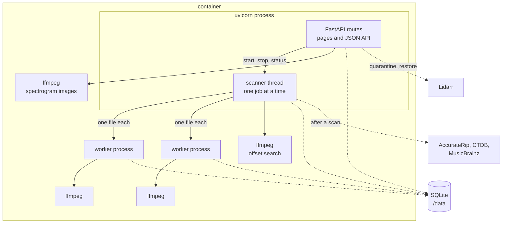
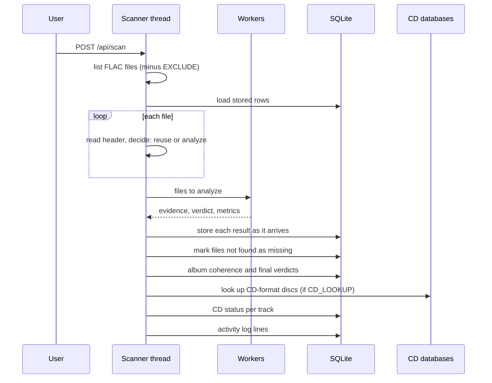
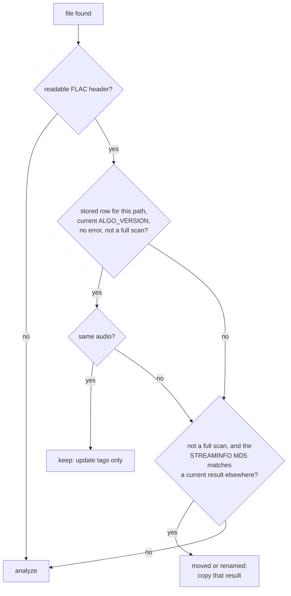

# Architecture: scans, caching and storage

flac-inquisitor is one Python process in one container. This page explains how
its parts run together, how a scan avoids repeating work, and where state is
kept.

## Processes and threads

- **Web routes** answer pages and API calls. They read the database and never
  wait for a scan.
- **The scanner** runs jobs on a background thread: a scan, or an offset search.
  Only one job runs at a time; both read whole albums and write their results.
  The pages poll its status once a second while it runs.
- **Worker processes** analyze files, `WORKERS` at a time. Each worker reads the
  header, runs one ffmpeg decode and evaluates the checks. Separate processes
  let NumPy work on several cores. Workers return their results to the scanner
  thread, which writes them to the database.
- **ffmpeg** runs as an external program: for decoding, for spectrogram
  images, and for the offset search.

The quarantine actions run in the web routes. They refuse to run during a scan,
because the scan holds a list of files that a move would invalidate.

## A scan, step by step

A **folder scan** does the same for one artist or album folder. It only marks
missing the files that were inside that folder, and only recomputes and checks
the albums it touched.

## Not doing the same work twice

Decoding is the expensive part: the first scan of a large library takes hours.
Later scans should take seconds. For each file found, the scanner reads only
its header and decides:

"Same audio" means: the STREAMINFO MD5 is unchanged, or, for files without one,
the size and modification time are unchanged.

Why the audio MD5 and not size and time: tagging tools rewrite the whole file.
Adding a cover or fixing a title changes the size and the time, but not a single
sample. Keying on the audio means a retag costs nothing, and a file moved to
another folder keeps its analysis. Ignores use the same key for the same
reason.

`ALGO_VERSION` in `detect.py` invalidates everything at once: when a check or a
threshold changes, the version goes up, and every stored result with an older
version is analyzed again on the next scan. The Dashboard says how many results
are outdated.

Settings that only change the grading, such as `UPSAMPLED_VERDICT`, do not
need a new analysis: verdicts are graded again from the stored evidence.

## Albums

A track's album is its parent folder, relative to the library. When the parent
is named like `Disc 1`, `CD2` or `disk 3`, the folder above it is the album.
The album key in URLs is a short hash of that path, stable across scans.

Albums are not stored as rows. Album verdicts, counts and lowest cutoffs are
computed by SQL from the tracks whenever a page needs them.

## Storage

Everything the app writes lives under `DATA_PATH`:

| Path | Content |
|---|---|
| `flac-inquisitor.db` | SQLite database in WAL mode. See [Database schema](../reference/database.md). |
| `spectrograms/` | PNG cache, keyed by audio MD5 and size. Safe to delete. |

Each database call opens a short-lived connection. With WAL, pages keep reading
while the scanner writes. Evidence and metrics are stored as JSON, so a new check
or measurement needs no schema change; columns added later are added on start
with `ALTER TABLE`.

The quarantine is plain folders and a `manifest.json` per day, readable without
the app; see [Quarantine folder](../reference/quarantine-folder.md).

## Network

The app makes outgoing requests only for:

- the CD check: AccurateRip, CTDB and MusicBrainz, with track lengths only,
  when `CD_LOOKUP` is on;
- Lidarr, when configured.

Requests carry a `User-Agent` with the app name, version and repository URL.
Nothing else leaves the container.
