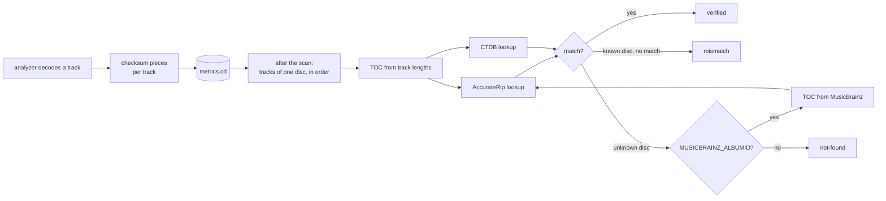

# CD verification: AccurateRip, CTDB and the offset search

The spectral checks look for traces of lossy coding. CD verification answers a
different question: **is this file a bit-exact copy of a pressed CD?** If it
is, nobody transcoded it on the way to you, whatever the spectrum looks like.

The code is in `cdverify.py`. Its formulas follow the cdtoc Rust crate and
the flaccuraterip Haskell package for AccurateRip, and the CUETools sources
(`CUETools.AccurateRip/AccurateRip.cs`, `CUETools.CTDB/CUEToolsDB.cs`) for
CTDB.

## The two databases

- **AccurateRip** collects, per disc layout, a checksum of every track from
  everyone who ripped that disc with supporting software. Each checksum comes
  with a **confidence**: how many rips agreed on it. Different pressings of
  the same album usually have different checksums.
- **CTDB** (CUETools database) stores, per disc, a CRC-32 of the whole disc's
  audio and, for most entries, a CRC-32 per track, also with a confidence.

Both are looked up by the **disc layout**, the table of contents (TOC): where
each track starts on the disc, in sectors of 588 stereo samples (1/75 s).

## What the check needs

A disc qualifies when every track is 44.1 kHz, 16-bit stereo, a whole number of
sectors long, and at least 5,880 samples long. Others are `unsupported`.

### Rebuilding the TOC

A track-by-track rip does not store the TOC, but on a normal CD the tracks
follow each other without gaps in the audio, so the lengths give it back:

- track 1 starts at sector 150 (the two-second lead-in every CD has);
- each next track starts where the previous one ends;
- the lead-out follows the last track.

Two things break this: a pregap before track 1 that the rip left out, and data
tracks of enhanced CDs. For the first, when no database knows the rebuilt TOC
and the files carry a `MUSICBRAINZ_ALBUMID` tag, the app asks MusicBrainz for
the release's disc IDs and tries every TOC whose track lengths agree with the
files, allowing track 1 to be longer by its pregap. Enhanced CDs and hidden
track one audio are not supported.

## AccurateRip

### Disc identifiers

With $o_i$ the start of track $i$ in sectors minus the 150-sector lead-in, and
$o_{n+1}$ the lead-out, the lookup URL is built from three numbers:

$$\text{id}_1 = \sum_{i=1}^{n+1} o_i \bmod 2^{32} \qquad \text{id}_2 = \sum_{i=1}^{n+1} \max(o_i, 1) \cdot i \bmod 2^{32}$$

and the classic freedb/CDDB disc ID. The file is
`dBAR-<tracks>-<id1>-<id2>-<cddb>.bin`, in folders named after the last three
hex digits of $\text{id}_1$.

The response holds one block per pressing: a 13-byte header, then for each
track one confidence byte, the 4-byte checksum, and 4 more bytes the app does
not use. The app adds up the confidence of each checksum over all pressings.

### Track checksums

Each stereo frame becomes a 32-bit word, left channel in the low half:

$$w_k = L_k + 2^{16} R_k \qquad (L_k, R_k \text{ as unsigned 16-bit})$$

For frame $k$ of a track (counting from 0), let $p_k = (k + 1) \cdot w_k$ as a
64-bit product. Then:

$$v_1 = \sum_k p_k \bmod 2^{32}$$

$$v_2 = \sum_k \big( (p_k \bmod 2^{32}) + \lfloor p_k / 2^{32} \rfloor \big) \bmod 2^{32}$$

Version 2 adds the high half of each product, which version 1 throws away. The
app accepts a match on either.

AccurateRip skips the edges of the **disc**: the first 2,939 frames of track 1
and the last 2,940 frames of the last track are left out of the sums (the
multiplier $k + 1$ still counts from the start of the track).

### Collecting the sums in one pass

The analyzer decodes each file on its own and does not know yet whether the
track is first or last on its disc. So, during the decode, `CDChecksums` keeps
six sums: $v_1$ and $v_2$ over the whole track, over its first 2,939 frames,
and over its last 2,940 frames. The sums are additive. Once the disc is
assembled, the head sums are subtracted from track 1 and the tail sums from the
last track. No second decode is needed.

## CTDB

CTDB uses a standard CRC-32 of the 16-bit little-endian PCM, over the disc
without:

- its first 10 sectors (5,880 frames), and
- its last $10 + \lfloor (N \bmod 5880) / 588 \rfloor$ sectors, where $N$ is the
  disc's length in frames: 10 to 19 sectors, depending on the disc.

The tail depends on the total length, unknown while one track decodes. So the
analyzer keeps the CRC of each track in pieces: the first 5,880 frames, the
middle, and each of the last 20 sectors separately. CRC-32 can be combined:
`zlib.crc32_combine(crc_a, crc_b, len_b)` gives the CRC of `a` followed by `b`
from the two CRCs and the length of `b`. After the scan, the pieces join into
any track CRC and into the disc CRC.

The lookup asks CTDB for "fuzzy" matches, which can return other layouts of the
same album. Only entries with the same total audio length are compared. A track
matches if the whole-disc CRC matches, or if the entry has per-track CRCs and
this track's matches.

## Outcome

| Status | Rule |
|---|---|
| `verified` | AccurateRip or CTDB gives a confidence above zero for the track. |
| `mismatch` | At least one database knows the layout, but this track matches nothing. |
| `not-found` | Neither database knows the layout. |
| `unsupported` | The disc does not qualify, see above. |

A database that cannot be reached leaves the disc unchecked and is reported in
the activity log; it is not counted as `not-found`.

Answers are cached in the database for 30 days, including "no such disc". Calls
are spaced: 0.5 s between requests to AccurateRip and to CTDB, 1.1 s to
MusicBrainz, which asks for at most one request per second.

## The offset search

Every CD drive starts reading a fixed number of samples early or late: its
**read offset**. Ripping software corrects it when configured. An uncorrected
rip holds the right audio, but each track boundary sits a few hundred samples
off, so every checksum differs and the disc shows as `mismatch`.

The offset search slides the track boundaries over the disc's audio and
recomputes the checksums for every shift $s$ from −2,939 to +2,939 frames. A
shift $s$ reads, for each track, the frames the rip holds $s$ later. When one
shift makes the tracks match, the rip was good all along.

### Making it fast

Recomputing a full checksum for 5,879 shifts would take thousands of passes
over the disc. Two identities make it one pass.

**AccurateRip v1.** Let the extended track be the track with $r = 2939$ frames
of its neighbours on each side, and $q = r + s$ the window start in it. With
$j = q + k$:

$$v_1(q) = \sum_{k} (k + 1)\, w_{q+k} = \sum_{j} (j - q + 1)\, w_j = B(q) - (q - 1)\, A(q)$$

where $A(q) = \sum_j w_j$ and $B(q) = \sum_j j\, w_j$ over the window. Moving the
window by one frame adds one frame at its end and drops one at its start, so
$A$ and $B$ for every $q$ follow from running sums over the $2r + 1$ frames at
each edge. All arithmetic wraps modulo $2^{64}$, which keeps the result right
modulo $2^{32}$.

**CTDB.** With $C(x)$ the CRC-32 of the first $x$ frames, the CRC of the range
$[a, b)$ is

$$\text{crc}[a, b) = C(b) \oplus \text{combine}\big(C(a), 0, 4(b - a)\big)$$

because CRC-32 is affine: the CRC of a concatenation is the shifted CRC of the
first part XOR the CRC of the second. Prefix CRCs are needed only at the
$2r + 1$ possible starts and ends.

Each track costs one decode plus $O(r)$ work at its edges, instead of $O(r)$
full passes.

### Memory

A whole disc decoded at once would need up to about 850 MB (80 minutes of
16-bit stereo). The search decodes one track at a time and keeps only the last
$r$ frames of the previous track and the first $r$ of the next. Before the
first track and after the last one it uses silence. The range of 2,939 frames
is no larger than the parts AccurateRip and CTDB skip at the disc ends, so the
silence never enters a checksum.

### Choosing the shift

For each shift the app counts matching tracks against both databases. The best
shift has, in order: the most matching tracks, then the highest total
confidence, then the smallest absolute value.

Sliding only works for AccurateRip v1. For tracks that v1 did not match at the
chosen shift, the app reads the track once more and computes $v_1$ and $v_2$
there directly.

The result, with the shift, is stored per track (`cd_offset`). Later scans keep
it; analyzing the files again clears it.

### Limit

A disc that AccurateRip only knows by v2 checksums, and that CTDB does not know,
cannot be found: v2 has no sliding identity, and testing 5,879 shifts directly
would cost thousands of passes.

## What a match proves, and what it does not

A match proves that the audio is bit-identical to rips of a pressed CD, so it
was not transcoded after ripping. It does not prove that the CD was mastered
from a lossless source: some CDs, especially cheap reissues and some
compilations, were made from MP3s. A CD-verified track that the spectral checks
flag is exactly that case.

No match proves nothing on its own. A different pressing, an uncorrected
offset, a read error, or a disc missing from the databases look the same.
