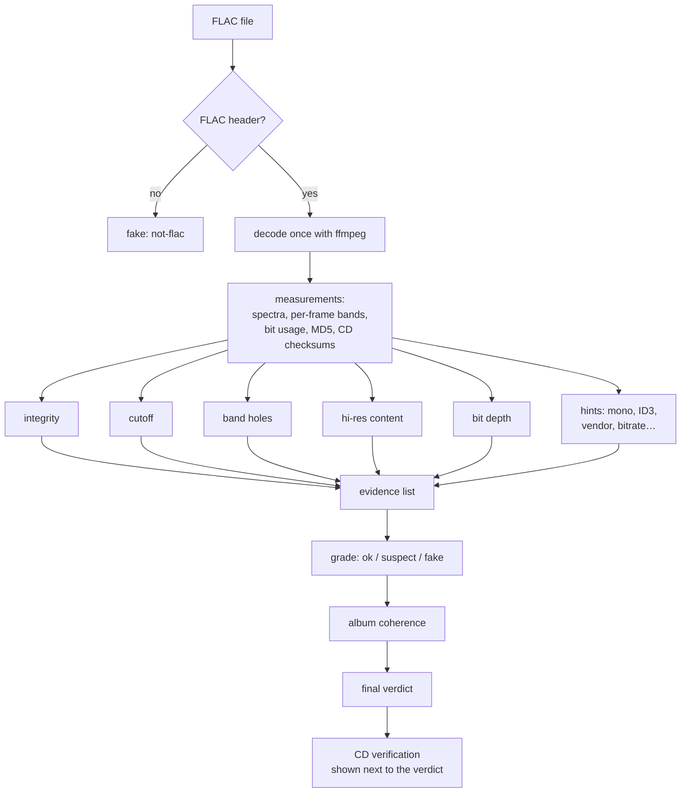

# How a fake FLAC is recognised

FLAC is lossless: it stores exactly the samples it was given. It cannot tell
whether those samples were themselves a perfect copy of a recording or the
output of an MP3 decoder. A "fake FLAC" is a file whose samples went through a
lossy or misleading step before they were packed into FLAC.

That step leaves traces in the audio. flac-inquisitor does not compare a file
with an original, which it does not have. It looks for the traces.

## The traces

### Lossy encoders throw away high frequencies

MP3, AAC, Vorbis and Opus save space by dropping what listeners hear least. The
first thing to go is the top of the spectrum: most encoders apply a steep
low-pass filter, whose frequency depends on the bitrate. In calibration, LAME at
128 to 192 kbps and AAC at 128 kbps cut at 16 to 17.5 kHz; MP3 at 320 kbps and
Opus at 20 to 20.5 kHz.

Real recordings also lose energy towards the top, but gradually: microphones,
instruments and analogue gear roll off smoothly. An encoder's filter is a
cliff. The **cutoff** check looks for a cliff, not for a lack of treble.

### Encoders switch bands on and off

Inside its pass band, an encoder still decides frame by frame which frequency
bands deserve bits. At high frequencies it often gives a band nothing for a
moment, while the bands on both sides keep playing. Music does not do that: an
instrument's overtones do not vanish in one narrow band and stay in the next.
The **band holes** check counts these moments.

High-bitrate encoders keep the top bands most of the time but still switch them
off now and then. The **per-frame bandwidth** measurement looks at how often
the top of the spectrum goes dark. It is measured and shown, not yet used for
the verdict.

### Resamplers leave a wall and an empty floor

A 96 kHz file made from 44.1 kHz audio has no real content above 22 kHz: the
original never had any. What is there is the resampler's anti-alias filter (a
steep drop between 20 and 26 kHz) and above it a flat noise floor. Real hi-res
recordings keep some structure up there: noise from the microphones and the
converters, harmonics, a gentle slope. The **hi-res content** check looks for
the wall and for the flat floor.

### Padded files leave low bits empty

A 16-bit recording stored as 24-bit has eight extra bits per sample that are
always zero. The **bit depth** check reads the actual sample values and counts
the low bits that are never used. lossyWAV, a lossy pre-processor for lossless
codecs, zeroes a varying number of low bits block by block; that pattern is
recognised too.

### Damage shows on decoding

FLAC stores an MD5 checksum of the original audio. Decoding the file and
hashing the result shows whether a single sample changed. Decoder errors and a
wrong length are reported too. This is the **integrity** check.

### Some files are not FLAC at all

A `.flac` name on an MP3 or Ogg file happens. The first bytes of the file say
what it really is.

### An odd track out

An album is normally mastered and released as a whole. A track with another
sample rate, a much lower cutoff, or mono audio in a stereo album points to an
album assembled from several sources. **Album coherence** compares each track
with the rest of its album.

### A perfect CD copy proves the rip

When a file is bit-identical to what other people ripped from the same CD, it
was not transcoded by whoever shared it. **CD verification** checks this with
the AccurateRip and CTDB databases. It cannot say how the CD itself was
mastered.

## From traces to a verdict

Every check writes a line of **evidence**: what it measured, the threshold it
compared against, and a sentence that explains the result. The verdict follows
from the evidence by fixed rules; see [Verdicts and album coherence](verdicts.md).
The user can always see why a file was flagged, and disagree.

## Where to go next

- [Reading a spectrogram](spectrograms.md): see the traces yourself.
- [The spectral algorithms](spectral-algorithms.md): how each spectral check
  measures, with the numbers.
- [Limits and false positives](limits.md): where the traces mislead.
