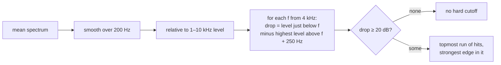
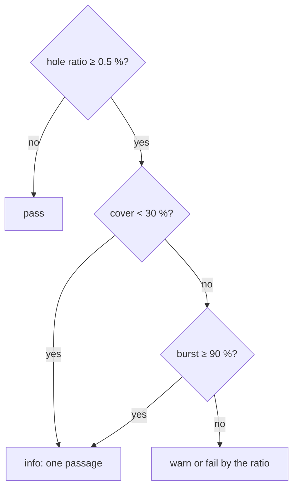
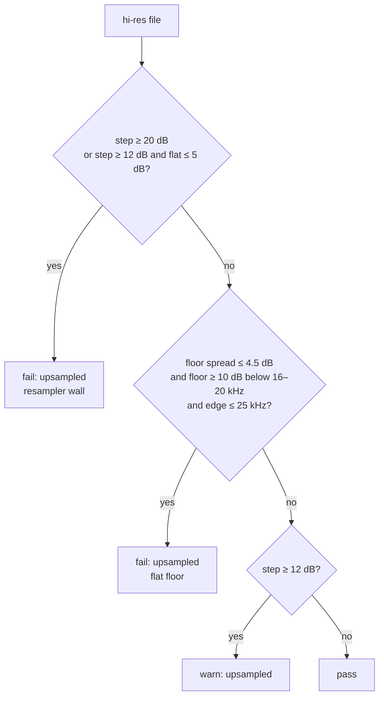

# The spectral algorithms

This page describes how the spectral checks measure, step by step, and where
their thresholds come from. The code is in `analyzer.py` (measurements) and
`detect.py` (checks). For the idea behind each check without the maths, read
[How a fake FLAC is recognised](detection.md) first.

## One pass over the audio

`analyzer.measure()` runs ffmpeg once per file and reads the decoded audio as
32-bit integers, 262,144 frames at a time. Memory use does not depend on the
length of the track. From each chunk it takes:

- the **mid channel** $m = (L + R) / 2$ (or the only channel of a mono file);
- **spectral frames**: windows of $N = 4096$ samples with a Hann window and 50 %
  overlap (hop 2048), carried across chunk boundaries. At 44.1 kHz one frequency
  bin is $44100 / 4096 \approx 10.8$ Hz wide and one frame lasts 93 ms.

Two things are kept from the spectra:

1. The **mean power spectrum** $\bar P(f)$, averaged over all frames.
   Normalised by the window energy, so levels do not depend on $N$.
2. **Per-frame band levels.** For each frame $t$:
   - the reference level $R_t$: mean power from 1 to 10 kHz, in dB;
   - for each 500 Hz band $b$ from 11 kHz up to 24 kHz (or Nyquist), its mean
     power in dB minus $R_t$:

     $$B_{t,b} = 10 \log_{10} \overline{P_t}(b) - R_t$$

   Relative levels make loud and quiet passages comparable. Below 11 kHz, MP3
   encoders rarely drop whole bands at usual bitrates, so lower bands are not
   kept.

All levels below are in dB relative to the 1–10 kHz mean of the same spectrum.

## Cutoff

**Question:** is there a frequency above which the spectrum falls off a cliff
and never comes back?

For each frequency $f$ from 4 kHz up:

$$\text{below}(f) = \text{mean of } L(f') \text{ for } f' \in (f - 500\,\text{Hz}, f]$$

$$\text{above}(f) = \max L(f') \text{ for } f' \in [f + 250\,\text{Hz}, f_{\text{Nyquist}}]$$

$$\text{drop}(f) = \text{below}(f) - \text{above}(f)$$

where $L$ is the smoothed relative level. Every $f$ with a drop of at least
20 dB is a candidate. Consecutive candidates form runs; the app takes the
topmost run and, inside it, the frequency with the largest drop.

Why the **maximum** above: an encoder's low-pass leaves nothing at all above the
edge, so even the loudest bin up there stays low. A dip in the music, a notch
filter or a quiet passage has something somewhere above it and does not pass.
A gentle analogue roll-off never drops 20 dB over 250 Hz, so it does not pass
either.

The 250 Hz gap skips the filter's own transition band.

**Thresholds.** In calibration, LAME at 128–192 kbps and AAC at 128 kbps cut at
16–17.5 kHz; MP3 at 320 kbps and Opus at 20.0–20.5 kHz; 49 of 58 genuine tracks
had no hard cutoff at all. Hence:

| Cutoff | Result |
|---|---|
| below 19,000 Hz | fail |
| 19,000–20,499 Hz | warn: high-bitrate MP3 cuts here, and so do some real recordings |
| 20,500 Hz or above, or none | pass |

## Band holes

**Question:** does a high band vanish for a moment while the bands on both sides
keep playing?

1. Keep only **loud frames**: $R_t \ge \text{median}(R) - 10$ dB. Quiet frames
   have little treble anyway.
2. Keep only bands that end at least 500 Hz below the cutoff (or Nyquist): the
   filter's slope is not a hole.
3. For each band, its **typical level** $\tilde B_b$ is its median over the loud
   frames. Bands whose typical level is below −80 dB are empty and dropped.
4. A **hole** at frame $t$, band $b$:

   $$B_{t,b} < \tilde B_b - 25 \quad\text{and}\quad B_{t,b\pm1} \ge \tilde B_{b\pm1} - 10$$

   The band is far below its usual level, and both neighbours are at theirs.
5. The **hole ratio** is the share of loud frames with at least one hole.

At least 20 loud frames and 3 non-empty bands are needed; otherwise the check
reports `info`.

Requiring both neighbours to play is what separates an encoder decision from
music. When the music itself gets darker, all bands drop together.

**Thresholds.** On genuine tracks, the 90th percentile of the ratio was
0.08 %; on LAME V0 fakes the median was 1 %. A ratio of 0.5 % warns and 4 %
fails.

### Holes in one passage

One kind of music makes real holes: a synth lead or a chiptune voice whose high
harmonics lie far apart. Between two harmonics a 500 Hz band can be empty while
the bands holding the harmonics are loud, and the typical level, taken over the
rest of the track, puts that band 25 dB or more higher. Encoding such a passage
as MP3 adds few holes of its own: the original already had them.

The difference is in time. An encoder drops bands all through a track, wherever
the music is hard to code; a tonal passage lasts as long as it lasts. The track
is cut into 10-second stretches, and two measurements describe where the holes
fall:

- **cover**: the share of stretches with loud frames that contain at least one
  hole;
- **burst**: the largest share of the hole frames within 3 consecutive
  stretches (30 seconds), for tracks of at least 6 stretches. In a shorter
  track, 30 seconds is most of the track and says nothing.

In calibration, the flagged lossy fakes (LAME V0, LAME 320, Vorbis q9) had a
cover of 0.47 to 1.00, except one Vorbis fake at 0.18 with a ratio of just
0.5 %, and a burst of at most 0.80. Genuine tracks with tonal passages had a
cover of 0.06 to 0.10, or, for a 72-second track, a burst of 1.00.

A fake whose only lossy trace sits in one passage is missed this way, and so is
a short insert of lossy audio: see [Limits](limits.md).

## Per-frame bandwidth

**Question:** how often does the top of the spectrum go dark?

For each loud frame, find the highest band with $B_{t,b} > -70$ dB and take its
top edge. The measurement is the **10th percentile** of these edges over the
loud frames: "in one loud moment in ten, nothing reaches above this".

High-bitrate MP3 and Vorbis keep a full band on average, which hides them from
the cutoff check, but switch off their top bands now and then. In calibration,
a 10th percentile below 20.5 kHz caught 11 of 18 LAME V0 and 13 of 25 Vorbis q9
fakes that every other check missed. It also caught 4 of 42 genuine tracks:
dark recordings. Until more ground truth is available, the value is stored and
shown as `info` when it is below 20.5 kHz, and does not affect the verdict. The
Accuracy page shows its distribution on CD-verified tracks, which is the data a
threshold needs.

## Hi-res content

Only for files above 48 kHz. Two independent tests look for audio that was
upsampled from 44.1 or 48 kHz.

### The resampler wall

A resampler's anti-alias filter makes a steep drop between 20 and 26 kHz. The
**step** is the largest drop from a 2 kHz stretch to the 2 kHz above it, for
edges $c$ from 20 to 26 kHz in 500 Hz steps:

$$\text{step} = \max_c \Big( \bar L(c - 2\,\text{kHz}, c) - \bar L(c + 0.5\,\text{kHz}, c + 2.5\,\text{kHz}) \Big)$$

The **flatness** is the range (max − min) of 1 kHz band levels from 27 kHz up to
40 kHz or Nyquist − 1 kHz. Above the wall, an upsampled file is a flat floor.

In calibration, 48 of 50 upsampled fakes had a step of at least 14.5 dB; real
hi-res at most 11 dB.

### The flat floor

Some upsampled masters had noise added after the upsampling step. The content
then fades into the noise without a clear wall, and the step stays small. What stays is the
floor: from about 23 kHz up it is flat, with no structure at all.

Three measurements, all relative to the 1–10 kHz level:

- **spread**: the difference between the 90th and 10th percentile of 500 Hz
  band levels from 26 kHz up to 40 kHz or 85 % of Nyquist, whichever is lower.
  The upper limit keeps the final anti-alias roll-off of the file out;
- **below**: the mean level from 16 to 20 kHz minus the median floor level. A
  flat full-band recording also has a small spread, but no step down to its
  floor;
- **edge**: the first 250 Hz band from 18 kHz up that is within 3 dB of the
  median floor: where the content ends.

The test fails when spread ≤ 4.5 dB, below ≥ 10 dB and edge ≤ 25 kHz.

In calibration, 46 of 47 such tracks had a spread of 0.2–4.4 dB and a "below"
of 12–31 dB; six genuine hi-res tracks had a spread of 6.6–16.7 dB. Six tracks
are little ground truth, and the margin to the flattest of them is 2.1 dB: this
threshold is the first candidate for review on the Accuracy page.

The edge is reported but does not name the source rate. Files upsampled from
44.1 kHz also reached their floor at 23–25 kHz in calibration, through the
resampler's roll-off, so the edge cannot tell 44.1 from 48 kHz.

### Severity

An upsampled file has lost nothing compared with the CD: it only claims a
quality it does not have. By default (`UPSAMPLED_VERDICT=suspect`) a fail in
the `upsampled` category makes a file suspect, not fake. See
[Verdicts](verdicts.md).
