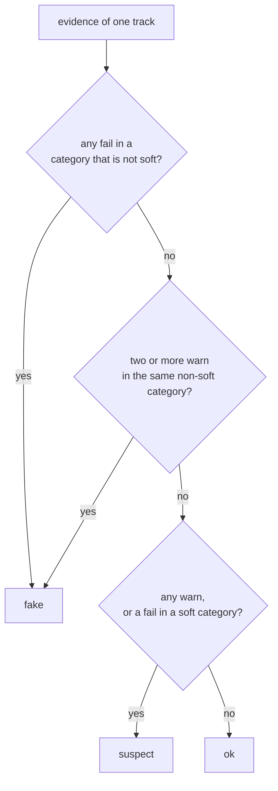

# Verdicts and album coherence

Each check produces evidence with one of four results: `pass`, `info`, `warn` or
`fail`, and for `warn` and `fail` a category such as `lossy-transcode`. The
verdict is a fixed function of that list. This page explains the function and
the album-level step that follows it.

## From evidence to a verdict

Why these rules:

- **One fail is enough.** A fail threshold is set where calibration found
  genuine files rarely or never, or where the trace has no common innocent
  explanation (a checksum mismatch, a cliff at 16 kHz).
- **A warning alone is a doubt.** Warn thresholds sit where fakes start to
  appear but some genuine recordings still reach.
- **Two warnings of the same cause add up.** A cutoff at 19.8 kHz *and* band
  holes both point to a lossy encoder. Two independent pieces of evidence for
  the same cause are as strong as one fail. Warnings of different causes do not
  add up: they are two unrelated doubts.
- **`info` never counts.** Hints such as ID3 tags or a vendor string help a
  human but are too weak, or too common in genuine files, to decide anything.

The **summary** shown under each track is the message of the first fail, or of
the first warning if there is no fail.

## Soft categories

Some findings describe a file that is misleading rather than damaged. An
upsampled hi-res file contains exactly what the CD contains; it only claims to
be more. By default (`UPSAMPLED_VERDICT=suspect`) the `upsampled` category is
**soft**: its fails count as warnings, and its warnings never pair up into a
fake. Such a file is **suspect** at most.

Set `UPSAMPLED_VERDICT=fake` to treat upsampling like any other fail.

The setting does not need a new analysis. The stored evidence already contains
everything; changing the setting grades every track again from it, in a few
seconds for a large library. The database remembers which value the stored
verdicts were graded with (`graded_upsampled_verdict`), so a change in the
environment between two starts is caught as well.

## Album coherence

After a scan, every album folder with at least three analyzed tracks gets a
second look. A track that differs from the rest of its album suggests a release
put together from several sources, even when the track passes every check on
its own.

The album folder is the track's parent folder; a parent named like `Disc 1`,
`CD2` or `disk 3` is folded into the folder above, so multi-disc albums are one
album.

Three comparisons, each giving a `warn`. A track gets at most one, the first
that applies:

1. **Format** (`album-format`, `mixed-sources`): the album has a strict
   majority format, such as `44100/16`, and this track has another.
2. **Fake stereo** (`album-mono`, `fake-stereo`): a strict majority of the
   album is real stereo, and this track is mono stored as stereo.
3. **Cutoff** (`album-cutoff`, `mixed-sources`): the track's effective cutoff
   is at least 2 kHz below the album median. A track with no hard cutoff counts
   at its Nyquist frequency.

"Strict majority" matters: in an album split 50/50 between two formats, neither
is the norm, so neither is flagged.

Album evidence raises an **ok** track to **suspect** and leaves suspect and fake
tracks as they are. It adds its category to the track's categories either way.
The track keeps its own verdict (`verdict` in the database) next to the final
one (`final_verdict`).

## Effective verdict

What the pages show and filter on is the **effective verdict**, decided in this
order:

1. **error** if the analysis failed;
2. **ok** if the track is ignored;
3. the final verdict, with album coherence, once the scan has computed it;
4. the track's own verdict while the scan is still running.

An album's verdict is the worst effective verdict among its tracks, in the order
fake, error, suspect, ok.

## CD verification is not part of the verdict

A **CD verified** badge does not turn a fake verdict into ok. The two answer
different questions:

- the verdict says whether the audio carries traces of lossy coding, resampling
  or padding;
- CD verification says whether the file is a perfect copy of a pressed CD.

Both can be true at once: a perfect rip of a CD mastered from MP3s. The app
keeps both. The Albums and Tracks lists leave verified CD rips out by default,
since no other copy of that edition can be better; the Dashboard counters, the
album pages and the Accuracy page still include them. The Accuracy page uses
the overlap to find checks that are too strict.

To make them count as OK everywhere, ignore them all from the Accuracy page
(see [Mark a false positive](../how-to/false-positives.md)). The Accuracy page
keeps grading them with the verdict of the checks.
