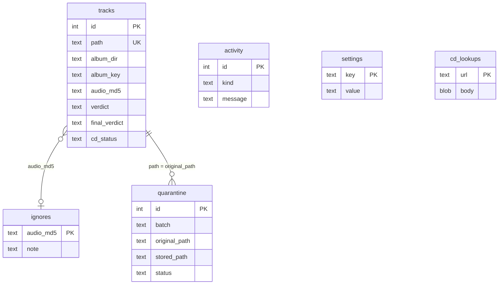

# Database schema

The app keeps its state in one SQLite file, `<DATA_PATH>/flac-inquisitor.db`,
in WAL mode. The schema is in `flac_inquisitor/db.py`. Tables are created on
start; columns added after the first release are added to older databases with
`ALTER TABLE` (`ADDED_COLUMNS`).

The music files remain the source of truth: deleting the database loses
ignores, the quarantine log and saved settings, and the next scan analyzes
everything again.

The relations are logical; there are no foreign keys.

## tracks

One row per FLAC file ever seen.

| Column | Type | Meaning |
|---|---|---|
| `id` | integer | Primary key. |
| `path` | text, unique | Path relative to the library. |
| `album_dir` | text | Album folder relative to the library. A parent folder named like `Disc 1`, `CD2` or `disk 3` is folded into its album. |
| `album_key` | text | First 12 hex digits of the SHA-1 of `album_dir`; used in URLs. |
| `size`, `mtime` | integer, real | File size and modification time at the last scan. |
| `streaminfo_md5` | text | MD5 from the FLAC header; `NULL` when the encoder left it empty. |
| `audio_md5` | text | MD5 of the decoded audio, computed by the analyzer. |
| `sample_rate`, `bits`, `channels`, `duration` | | Format, from the header. |
| `artist`, `album`, `title`, `disc`, `track` | | From the tags. `artist` prefers `ALBUMARTIST`. |
| `algo_version` | integer | `ALGO_VERSION` of the analysis. |
| `verdict` | text | The track's own verdict, graded from its evidence. |
| `categories` | JSON | Categories of its own warn and fail evidence. |
| `summary` | text | Message of the strongest evidence. |
| `evidence` | JSON | List of evidence objects: `check`, `result`, `message`, `category`, `value`, `threshold`. |
| `metrics` | JSON | Measured values; see [Checks](checks.md#measured-values). |
| `album_evidence` | JSON | Album coherence evidence, a list of at most one object, or `NULL`. |
| `final_verdict` | text | Verdict including album coherence. |
| `final_categories` | JSON | Categories including album coherence. |
| `error` | text | Why the analysis failed; `NULL` when it worked. |
| `analyzed_at` | text | ISO 8601 time of the analysis. |
| `missing` | integer | `1` when the last scan did not find the file, or it was quarantined. |
| `cd_status` | text | `verified`, `mismatch`, `not-found`, `unsupported`, or `NULL` if not checked. |
| `cd_ar` | integer | AccurateRip confidence of the match. |
| `cd_ctdb` | integer | CTDB confidence of the match. |
| `cd_offset` | integer | Shift in samples found by an offset search; `NULL` otherwise. |

## ignores

| Column | Meaning |
|---|---|
| `audio_md5` | Primary key. Ignoring by audio survives retagging and renames. |
| `note` | Optional note. |
| `created_at` | When it was ignored. |

## quarantine

One row per moved file. Same fields as
[manifest.json](quarantine-folder.md#manifestjson), plus:

| Column | Meaning |
|---|---|
| `id` | Primary key; the entry id of the API. |
| `status` | `quarantined`, `restored` or `deleted`. |
| `resolved_at` | When it was restored or deleted. |

## activity

The **Recent activity** log: `at` (time), `kind` (`scan`, `cd-check`,
`quarantine`, `restore`, `delete`, `ignore`, `settings`, `lidarr`) and
`message`.

## settings

Key–value pairs saved from the Settings page, plus internal state:

| Key | Meaning |
|---|---|
| any setting key | See [Settings](settings.md). |
| `graded_upsampled_verdict` | The `UPSAMPLED_VERDICT` the stored verdicts were graded with. When it differs from the current value, every verdict is graded again. |

## cd_lookups

Cache of CD database answers: `url`, `body` (`NULL` when the server had no
entry) and `fetched_at` (Unix seconds). Entries are used for 30 days.
