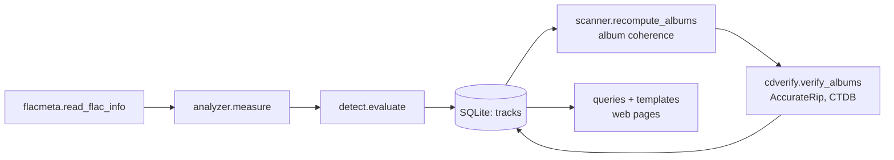

# Development setup

In this tutorial you run flac-inquisitor from a checkout of the source code,
run the test suite, and follow one file through the analysis from a Python
shell. At the end you know where each part of the code lives.

You need:

- [uv](https://docs.astral.sh/uv/), which also installs the right Python
  version;
- ffmpeg on your `PATH`, built with libmp3lame and libopus. The tests make their
  fake files with these encoders;
- git.

## 1. Get the code and the dependencies

```sh
git clone https://github.com/Fede-26/flac-inquisitor.git
cd flac-inquisitor
uv sync
```

`uv sync` creates `.venv` with the Python version that `pyproject.toml` asks
for, the runtime dependencies (FastAPI, NumPy, SciPy and a few more) and the
development group (pytest, the HTTP client the tests use).

## 2. Run the tests

```sh
uv run pytest
```

The first run takes longer: `tests/conftest.py` synthesises a few seconds of
pink noise and turns it into real FLAC files and real fakes with ffmpeg (MP3 at
128 and 320 kbps, AAC, Opus, an upsampled copy, a padded 24-bit copy and more).
No real music is used. Every test should pass; one is marked `xfail` because it
documents a known blind spot.

If a fixture fails with an ffmpeg error such as `Unknown encoder 'libmp3lame'`,
your ffmpeg lacks that encoder. Install a full build.

## 3. Run the app

The app reads its settings from environment variables. Point it at a small
folder of FLAC files and at two scratch folders:

```sh
mkdir -p /tmp/fi/data /tmp/fi/quarantine
DATA_PATH=/tmp/fi/data \
LIBRARY_PATH=/path/to/some/flac/albums \
QUARANTINE_PATH=/tmp/fi/quarantine \
CD_LOOKUP=false \
uv run uvicorn flac_inquisitor.main:app --reload --port 8080
```

`CD_LOOKUP=false` keeps the scans off the network while you work. Open
`http://localhost:8080` and press **Scan**. With `--reload`, uvicorn restarts
when you save a Python file; templates and static files are read on each
request.

Use a copy of your albums, not the originals, if you plan to try the quarantine:
it moves files.

## 4. Follow one file through the analysis

Open a Python shell in the project environment:

```sh
uv run python
```

Read the header, decode the audio and grade it, one step at a time:

```python
from flac_inquisitor.flacmeta import read_flac_info
from flac_inquisitor.analyzer import measure
from flac_inquisitor.detect import evaluate

path = "/path/to/some/flac/albums/Artist/Album/01. Track.flac"
info = read_flac_info(path)       # STREAMINFO, tags, ID3 presence; no decoding
info.sample_rate, info.bits_per_sample, info.md5_hex

m = measure(path, info)           # one ffmpeg decode: spectra, bit usage, MD5, CD checksums
m.mid_power.shape, m.band_db.shape

result = evaluate(info, m)        # evidence and verdict
result.verdict, result.categories
for e in result.evidence:
    print(e.result, e.check, e.message)
```

These three calls are what every scan worker does for every file
(`scanner.analyze_track`). Everything after this point is storage and display:



## 5. Find your way around

| Module | Job |
|---|---|
| `flacmeta.py` | Parses FLAC metadata blocks without decoding audio. |
| `analyzer.py` | Decodes once with ffmpeg and collects every measurement. |
| `detect.py` | Turns measurements into evidence, a verdict and album coherence. All thresholds live here. |
| `cdverify.py` | AccurateRip and CTDB checksums, lookups and the offset search. |
| `scanner.py` | Finds files, decides what to re-analyze, runs the worker pool, stores results. |
| `quarantine.py` | Moves files out of the library and back, with the manifest. |
| `lidarr.py` | Optional rescan request to Lidarr. |
| `db.py`, `queries.py` | SQLite schema and the read-side queries of the pages. |
| `settings.py` | Settings from environment, database or defaults, and their validation. |
| `main.py` | FastAPI routes: HTML pages and the JSON API. |

[Code layout](../reference/code-layout.md) has the full list, and
[Architecture](../explanation/architecture.md) explains how the pieces run
together.

## What you have done

You ran the tests and the app from source, and called the three functions that
make a verdict. Next:

- change a threshold or add a check: [Add or change a check](../how-to/add-a-check.md);
- measure the effect on real music: [Recalibrate the thresholds](../how-to/calibrate.md).
